# XSwap

**Swap any token `X` for any token `Y`.**

XSwap is a non-custodial swap interface built on Uniswap v3. It quotes and settles trades
across **Ethereum, Arbitrum, Base and OP** — across every live fee tier for the pair — with a
green/jade take on [Uniswap's reference design system](./design.md).

> **Live app → [xswap.netlify.app](https://xswap.netlify.app/)**
>
> *XSwap is an unofficial interface and is not affiliated with Uniswap Labs.*

[](https://react.dev/)
[](https://vite.dev/)
[](https://www.typescriptlang.org/)
[](https://tailwindcss.com/)
[](https://viem.sh/)
[](https://docs.uniswap.org/)

---

## At a glance

- **No backend, no indexer, no API key.** The page talks only to public RPCs.
- **Real routing.** `factory.getPool` is called for each of the four fee tiers, quotes come
  from the on-chain Quoter, settlement goes through `SwapRouter02`. Slippage enforced by the router.
- **Wallets first.** A button, not a wallet-search field, plus an in-app preview wallet
  so the UI can be tried on any deployment instantly.
- **Token icons that actually load** — verified, checksummed asset URLs with a
  deterministic monogram fallback. The balances below it are real on-chain values.
- **Pixel aligned.** Rounded 20px panels, a 36px amount, fine-tuned spacing — matches the
  Uniswap reference design system at the badge, pill and control-button level.

---

## Screenshots

### Swap card — the product surface

Every panel is 20px radius with 16px padding. The flip connector overlaps both panel edges
and owns its own stacking context so it never gets clipped.

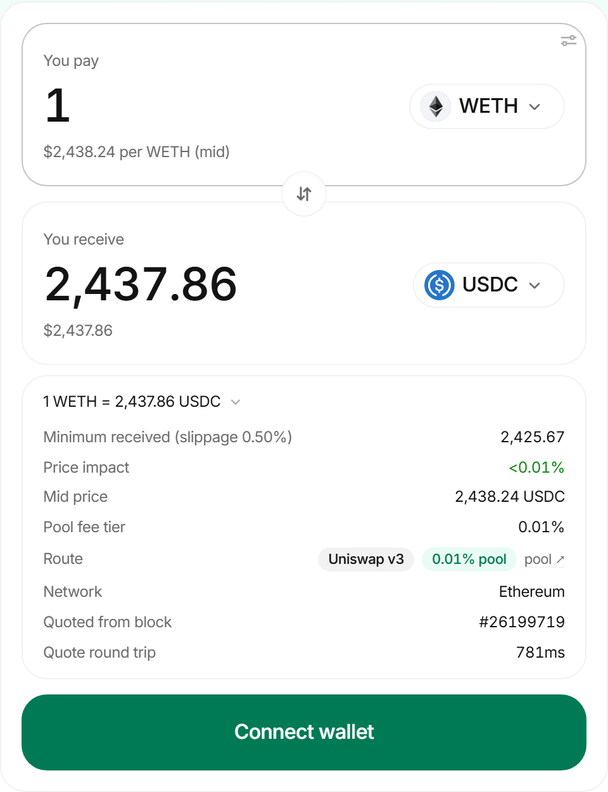

### A live quote

Type an amount and it resolves the best route: `1 WETH → ~2,434 USDC` through the 0.01%
tier, with the mid-price, price impact, minimum received and the pool badge.

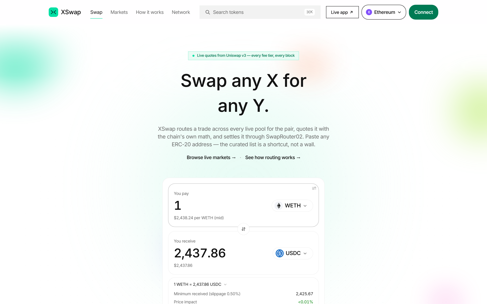

### Connected — balances, approval gate, recipient control

One click connects a real wallet (or the built-in preview wallet). The input panel shows
the live balance, the card only offers `Swap` when within balance, `Max` presets to balance,
and the approve gate appears automatically when the allowance is zero.

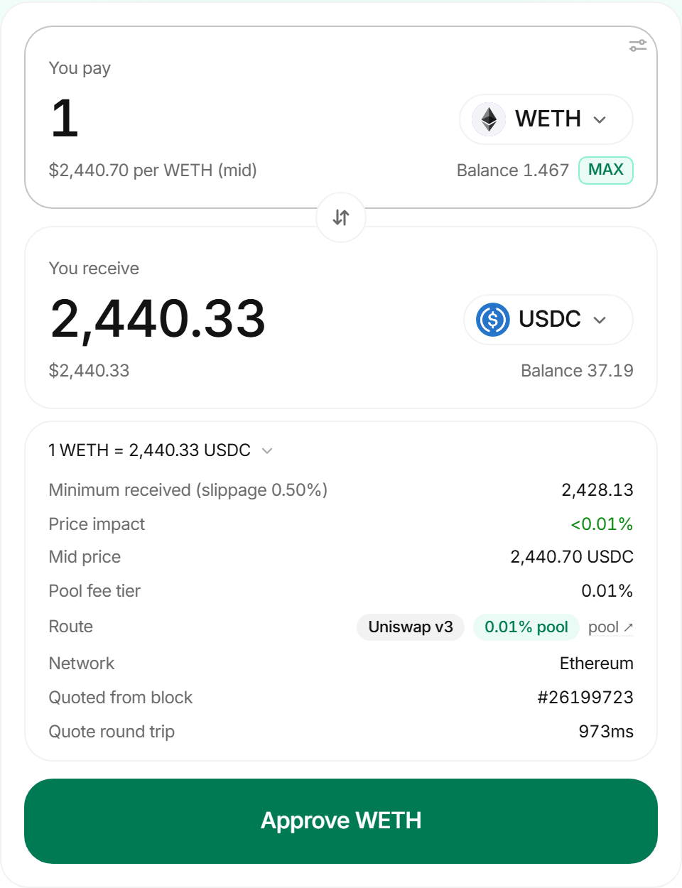

The account menu shows live on-chain per-token balances plus a copy-address / explorer
shortcut.

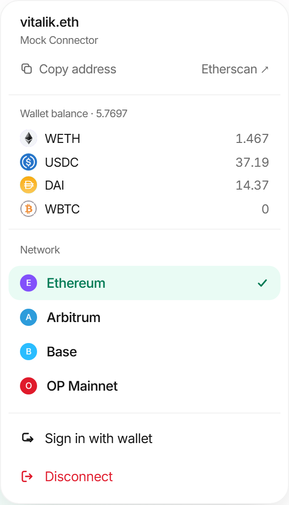

### Markets

Live pool state for the base/quote pairs across all four chains, refreshed every minute.
No fake TVL, no synthetic volume — just what the chain can prove.

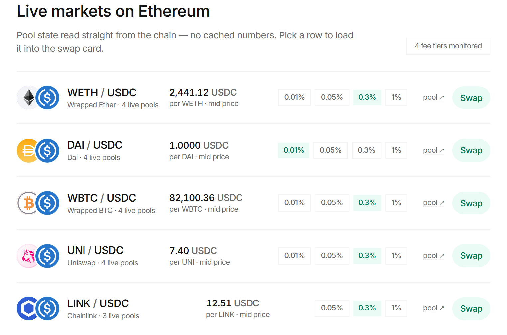

### Routing engine, displayed honestly

How a swap is discovered, quoted and settled — and the numbers the app is doing it with,
rendered next to the explanation.

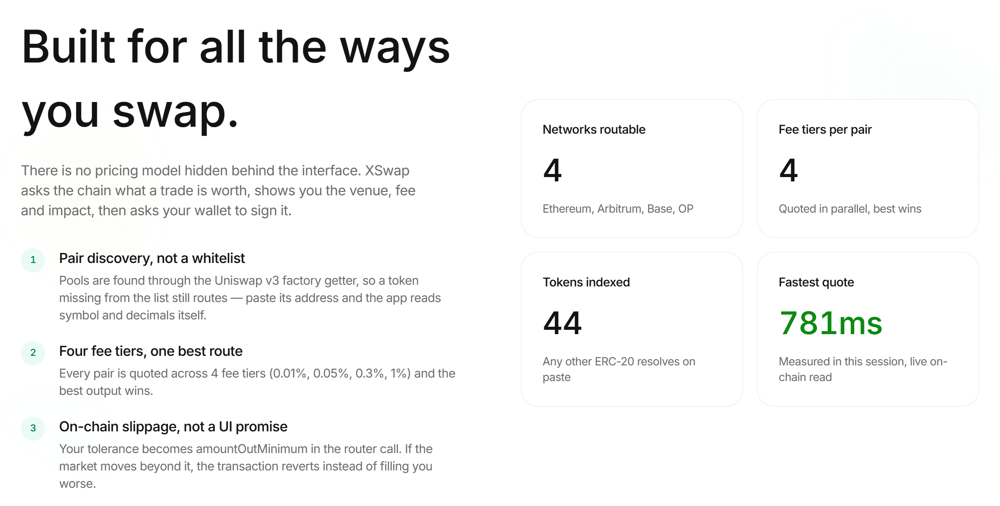

### Token picker and slippage control

Includes a verified-tokens list, on-the-fly pasting of any ERC-20 address (resolved
on-chain via `name` / `symbol` / `decimals`), and slippage & deadline settings with
partial-fill protection.

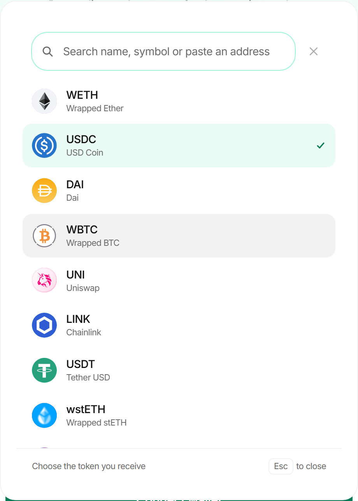
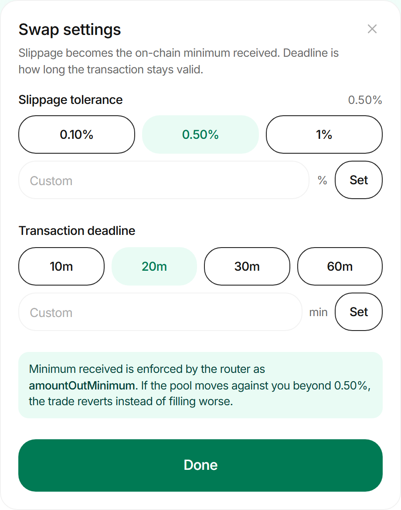

### Wallet connection flow

Three layers of connectors (wallet extensions, QR-based wallets, mobile wallets) plus
the in-app preview wallet for trying the UI with no extension installed.

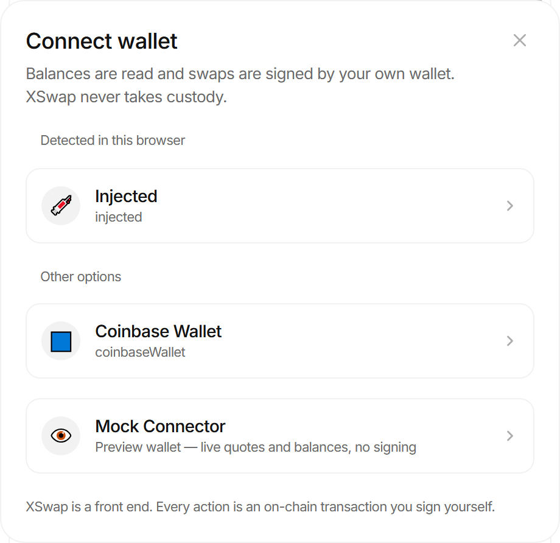

### Footer

Attribution, the live link and the honest disclaimers, in one bottom bar.

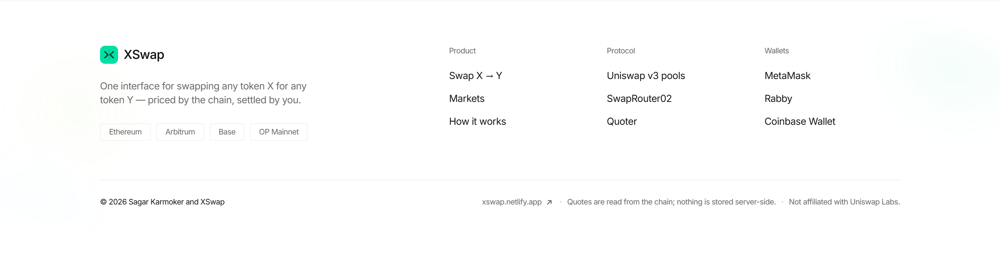

### Mobile

Responsive down to a single column — stacked panels, a one-hand-friendly connect bar.

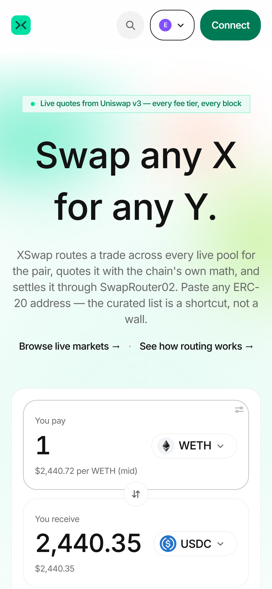

---

## How the routing works

1. **Discover.** For the current pair, call `UniswapV3Factory.getPool(tokenA, tokenB, fee)`
   for fees `100, 500, 3000, 10000`. Pools that return `address(0)` don't exist — skipped.
2. **State.** Read `slot0`, `liquidity`, `feeGrowth` and the current tick from each pool;
   drop pools with zero liquidity.
3. **Quote.** Call `Quoter.quoteExactInputSingle` for each surviving pool at the user's
   amount; the Quoter simulates and returns an exact output, including the price impact.
4. **Rank.** Pick the pool with the highest output; show the delta vs. mid price.
5. **Settle.** `exactInputSingle` on `SwapRouter02`, with `amountOutMinimum =
   amountOut * (1 − slippage)`. Approvals are batched into the same `multicall` when the
   input token is an ERC-20.
6. **Re-check before signing** — a fresh quote is taken the moment the user clicks swap,
   so a moved market can't be committed to accidentally.

Quotes auto-refresh every 20 seconds.

---

## Runtime behaviour

| Feature | Detail |
| --- | --- |
| Chains | Ethereum · Arbitrum · Base · OP |
| Tokens | 44 curated (16 on Ethereum, 10 on Arbitrum, 8 on Base, 10 on OP), plus arbitrary pasted addresses |
| Swap tiers | 0.01% · 0.05% · 0.3% · 1% — ranked automatically |
| Slippage | 0.05% · 0.1% · 0.5% presets, up to 5% custom |
| Deadline | Up to 72 hours out, encoded as `block.timestamp + minutes × 60` |
| Recipient | Self, or any address, stored locally |
| Approvals | Approval only for the entered amount, with one-transaction approve-then-swap |
| Refresh | quotes 20s · balances 30s · market rows 60s |
| Networks | Auto-switch when the selected token's chain differs from the active one |

---

## Tech stack

| Layer | Choice |
| --- | --- |
| Framework | React 19 + TypeScript 5.9 (strict) |
| Bundler / dev | Vite 6 |
| Styling | Tailwind CSS v4 with `@tailwindcss/vite` (no PostCSS, no config) |
| Contracts | viem 2.47 — reads, multicall, and writes |
| RPC | `http()` transports with fallback hosts; no API key required |
| Wallets | Native EIP-1193 provider discovery + an in-app preview wallet |
| Formatters | `Intl.NumberFormat` with tabular numerals |
| Icons | Verified asset URLs + deterministic monogram fallback |

---

## Quick start

Prerequisites: [Node.js 20+](https://nodejs.org/) and [pnpm 9+](https://pnpm.io/).

```bash
git clone https://github.com/sagarkarmoker/xswap.git
cd xswap
pnpm install
pnpm dev
```

Open <http://localhost:5173>. Clicking **Connect wallet** opens a dialog with
three connector tiers plus a **Preview wallet** button that pretends to be the
vitalik.eth address, so every UI path can be exercised with no extension installed.

Production build with a type check:

```bash
pnpm typecheck
pnpm build
pnpm preview          # serves dist/ on http://localhost:4173
```

---

## Scripts

| Script | What it does |
| --- | --- |
| `pnpm dev` | Start the Vite dev server with HMR |
| `pnpm build` | Production bundle into `dist/` (TypeScript project references compiled first) |
| `pnpm typecheck` | `tsc -b` without emitting — what CI would run |
| `pnpm preview` | Serve `dist/` locally |
| `pnpm check:deployments` | Live-check factory / quoter / router on all four chains, plus every curated token's checksum and on-chain `symbol` / `decimals` |
| `pnpm tokens:logos` | Regenerate `src/config/token-logos.ts` (verifies each asset URL) |
| `pnpm tokens:check-logos` | Validate token logos without rewriting them |

---

## Project structure

```
xswap/
├── design.md                     # the design system we target
├── AGENTS.md                     # agent constraints and build notes
├── index.html                    # fonts, canonical, OG, manifest
├── src/
│   ├── components/
│   │   ├── layout/               # nav-bar, footer, ErrorBoundary wiring
│   │   ├── swap/                 # swap-card, amount-panel, quote-details
│   │   ├── markets/              # markets table
│   │   ├── wallet/               # connectors, chain switcher, account menu
│   │   └── ui/                   # token-icon, kbd, copy-button, orbs
│   ├── config/                   # chains, tokens, token-logos, site
│   ├── hooks/                    # useToken (balances, allowance, resolution)
│   ├── lib/                      # router (discovery, quotes, math)
│   └── styles/                   # index.css — tokens, typography, animations
├── scripts/
│   ├── check-deployments.mts     # live RPC health check
│   ├── fetch-token-logos.mts     # asset URL verifier
│   └── logos.json                # curated logo map
├── public/
└── docs/screenshots/             # everything above
```

---

## Configuration

No environment variables are needed for a working build. Public RPC hosts are the default
and degrade gracefully when rate-limited.

| Variable | Purpose | Default |
| --- | --- | --- |
| `VITE_INFURA_KEY` | Optional Infura RPC key for Ethereum | unset (public fallback) |
| `VITE_ALCHEMY_KEY` | Optional Alchemy RPC key for Ethereum | unset |

Additions go in `.env.local` and are read through `src/config/env.ts`.

Adding a chain is two edits: one entry in `supportedChains` (with factory / quoter / router
addresses) and the corresponding token list in `src/config/tokens.ts`. The deployment check
fails the build if the DEX addresses are wrong.

Adding a token is one line in `src/config/tokens.ts`. Run `pnpm tokens:logos` afterwards to
fetch its logo, or fall back to the auto-generated monogram if no icon is available.

---

## Quality notes

- **`pnpm typecheck`** is strict and passes with no errors.
- **`pnpm check:deployments`** runs against live RPCs for all four chains on every cadence.
- **No silent failures.** When balances / allowances can't load, the card shows `—` rather
  than `0`, and every failure is logged with the offending callback name.
- **Verified token registry.** EIP-55 addresses are checked against public RPCs; any wrong
  checksum or changed `symbol` / `decimals` fails the deployment check.
- **Accessibility.** `aria-live` on price rows, a logical tab order through the card, and a
  fully keyboard-controllable picker, including pasting a new token on paste.

---

## Known limitations

- **Uniswap v3 only.** Uniswap v2 liquidity is deliberately *not* quoted — the mainnet v2
  USDC/WETH pair is effectively empty, so including it would make quotes worse, not better.
- **No indexer.** The markets table shows live pool state, not 24h volume or TVL — those
  would need a paid data source, and they'd be guesses anyway.
- **Manual recipient checks are the user's responsibility.** The recipient row warns, but
  nothing can verify that an arbitrary hex address is the right one.
- **Public RPCs** can rate-limit the quote-refresh cadence during peak hours; the
  `Infura` / `Alchemy` keys above fix that.

---

## Contributing

Issues and pull requests are welcome.

Before sending a PR, please run:

```bash
pnpm typecheck
pnpm check:deployments
pnpm build
```

Small commits, atomic diffs, and a one-line description of the intended user-facing change
in the PR body. The design tokens in `src/styles/index.css` and the Uniswap v3
configuration in `src/config/chains.ts` are the only places that usually need updating
when forking.

---

## Author & attribution

XSwap is built by **Sagar Karmoker**.

XSwap is an unofficial interface and is not affiliated with, endorsed by, or connected to
Uniswap Labs. "Uniswap" is a registered trademark of Uniswap Labs LLC.
The template design system is adapted from [`design.md`](./design.md).

© 2026 Sagar Karmoker and XSwap. All rights reserved.

[](https://github.com/sagarkarmoker/xswap)
[](https://xswap.netlify.app/)
